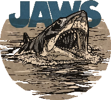

# Jaws Board game AI Companion
> We're gonna need a bigger boat.


A companion app for the *Jaws* board game (Ravensburger, 2019) that plays the shark in Act I, so the crew can play solo or cooperatively. Built with **Phaser 3.90 + TypeScript + Vite**, tested with **Vitest**, and packaged for Android with **Capacitor 8**.

- Web version: https://robojaws.netlify.app/
- Android: [Jaws Companion App on Google Play](https://play.google.com/store/apps/details?id=com.netlify.JawsCompanion)
- Languages: English, Spanish, German, Russian and Italian

## Prerequisites

You'll need [Node.js](https://nodejs.org/en/) **22 or newer** and npm (it comes with Node.js). Building the Android app with Capacitor 8 needs Node 22; the web version alone runs on Node 20.

It is highly recommended to install Node.js with [Node Version Manager](https://github.com/nvm-sh/nvm) (nvm), or [nvm-windows](https://github.com/coreybutler/nvm-windows) on Windows:

```bash
nvm install 22
nvm use 22
```

## Getting Started

Clone this repository and install the dependencies:

```bash
git clone https://github.com/plissken2013es/JawsAICompanion.git
cd JawsAICompanion
npm install
```

Start the development server and open http://localhost:8000:

```bash
npm start
```

## Commands

| Command | What it does |
|---|---|
| `npm start` | Development server with hot reload on http://localhost:8000 |
| `npm test` | Runs the test suite (Vitest) |
| `npm run lint` | Lints `src/` with ESLint |
| `npm run build` | Production build of the web version into `dist/` |
| `npm run preview` | Serves the production build locally |
| `npm run build:android` | Production build + `npx cap sync android` |

The web version is just the contents of `dist/`: upload them to any static web server. 🎉

## Android app

The Android project lives in `android/` (Capacitor 8, target SDK 36). You'll also need [Android Studio](https://developer.android.com/studio) with its JDK 21.

```bash
npm run build:android    # build the web app and copy it into android/
npx cap open android     # open the project in Android Studio
```

From Android Studio you can run it on an emulator or a phone. Release builds are signed with the publisher's upload key, which is not in this repository (`android/key.properties` and the keystore are git-ignored): debug builds work without it, and for your own release builds create your own keystore.

## Project Structure

```
    .
    ├── android/            Capacitor Android project
    ├── ios/                Capacitor iOS project
    ├── public/             static assets (img, audio, fonts, scripts)
    ├── src/
    │   ├── consts/         enums and configuration (zones, characters, map, graph…)
    │   ├── objects/        game entities and widgets (Board, Zone, Swimmer, Hunter…)
    │   ├── scenes/         Phaser scenes (LanguageSelection, Intro, Game, FinalOptions…)
    │   ├── utils/          the shark AI, pathfinding, texts, saving, logs
    │   ├── index.html
    │   └── main.ts         entry point referenced by index.html
    ├── tests/              Vitest suites (with a Phaser stub in tests/setup)
    ├── capacitor.config.ts
    ├── vite.config.ts
    ├── vitest.config.ts
    └── package.json
```

If you want to know how the shark thinks and behaves, go straight to `src/utils/JawsAI.ts`; it finds its way around the board with `src/utils/DijkstraManager.ts`.

## Static Assets

Static assets like images or audio files go in the `public` folder. They are served from the root path, e.g. `http://localhost:8000/img/my-image.png`, and copied into `dist/` on build.

Phaser loads them like this: `this.load.image('my-image', 'img/my-image.png')`.

The dev server port is set in `vite.config.ts` (`server: { port: 8000 }`).

## Translating the app

The app currently speaks English, Spanish, German, Russian and Italian, and new languages are very welcome. Please open your pull request **on this repository** (`src/`), not on [JawsDist](https://github.com/plissken2013es/JawsDist): JawsDist only holds the compiled build that the web version is deployed from, so changes made there would be lost with the next release and would never reach the Android app.

To add a language (using Italian, `IT`, as the example), this is where the texts live:

- `src/consts/Languages.ts`: add the language code to the enum (`Italian = "IT"`).
- `src/utils/LocaleManager.ts`: the UI texts. Each English text is a key, and you add a line with your code next to the existing translations:
  ```ts
  "End Turn": {
    ES: "Fin Turno",
    DE: "Zug beenden",
    RU: "Конец хода",
    IT: "Fine Turno"
  },
  ```
  Keep the `\n` line breaks: the texts have to fit their boxes on screen.
- `src/utils/FlavorTextsManager.ts`: the movie quotes shown during the game. **Please keep them as close as possible to the actual lines of the film as dubbed in your language**, rather than translating the English quotes: the translators of the other languages matched the dubbed dialogue too.
- `src/scenes/Preloader.ts`: the non-profit disclaimer shown on startup (`legalTextEN`, `legalTextES`, …). Add your own array and its `case` in the `switch`.
- `src/scenes/StudiosLogo.ts`: the "Proudly presents..." line.
- `src/scenes/LanguageSelection.ts` and `public/img/flag_xx.png`: the flag on the language screen (a 128×128 PNG, like the other flags). The flags are placed by hand, so they need re-spacing when you add one.
- `src/scenes/FinalOptions.ts`: the credits. Add yourself as "*Language* translation: *your name*".
- `tests/utils/LocaleManager.test.ts`: a few tests for your language, like the existing ones.

Check your work before opening the pull request:

```bash
npm test        # all tests must pass
npm start       # http://localhost:8000: choose your flag and play a few turns
```

Any text you don't translate falls back to English, so a partial translation won't break anything, but it will show up in English in the app.

## License

[MIT License](LICENSE)
